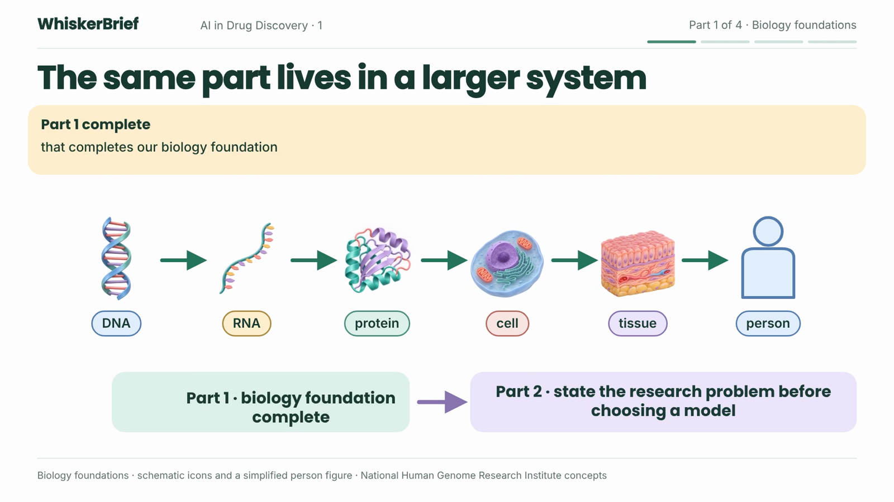
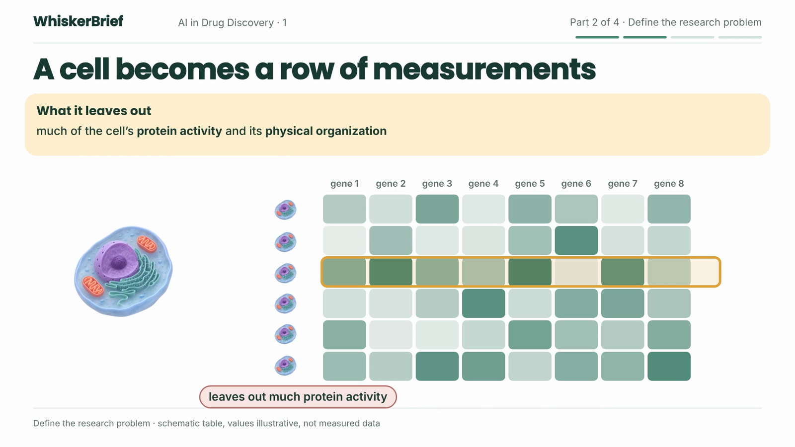
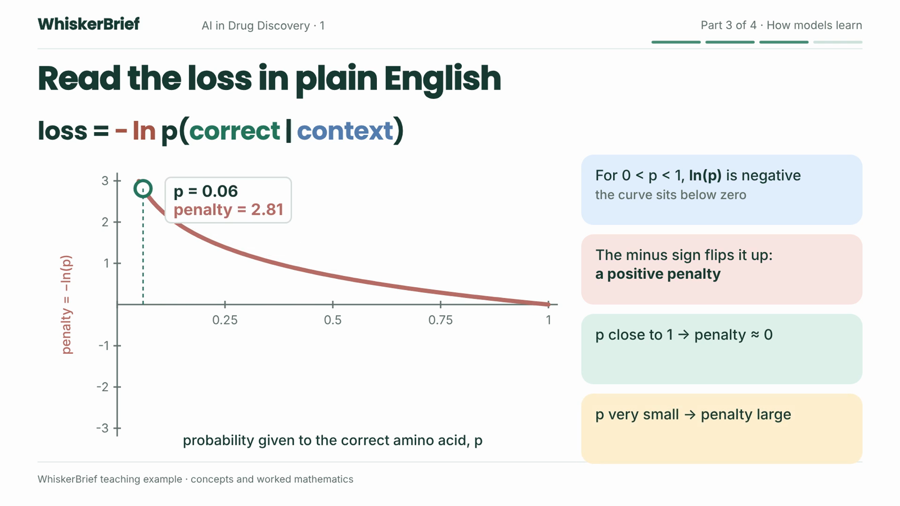
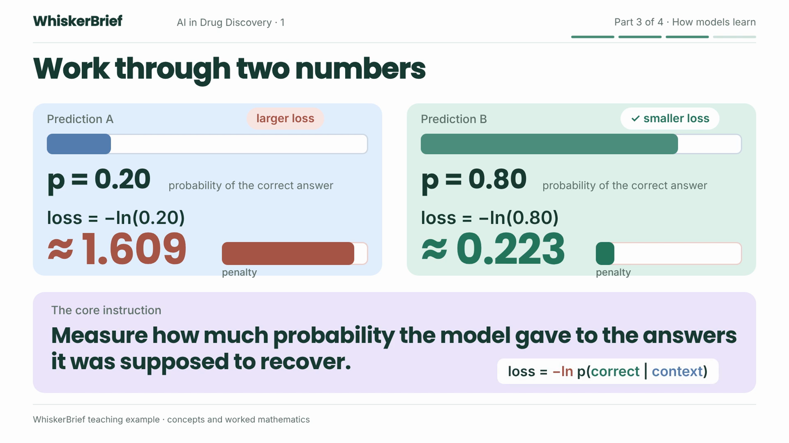
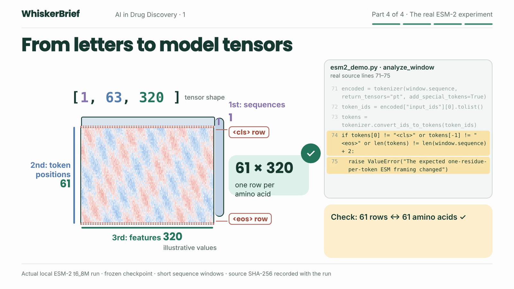
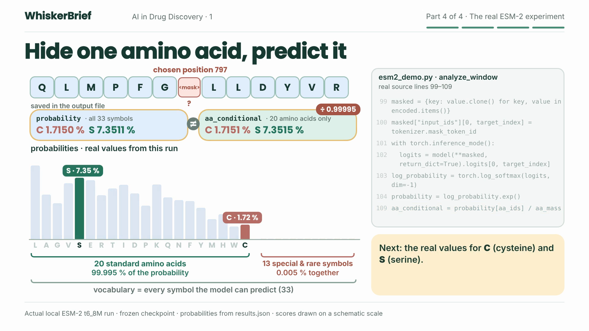
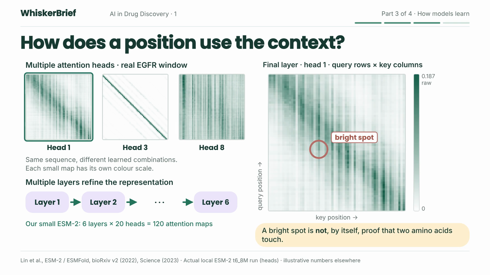

# Can AI Simulate a Cell? Biology Basics and a First Protein Language Model with ESM-2

*Part 1 of the AI in Drug Discovery course*

In this tutorial, we will find out what it means to "simulate a cell" with artificial intelligence today. We will learn the biology we need, see how a model learns from examples, and then run a small protein language model on a real protein sequence.

You do not need to know biology or machine learning already. We will explain each important word when we meet it.

A "virtual cell" model takes information about cells and a change we want to study, for example switching off a gene. It then predicts some part of the resulting cell state, usually a pattern of RNA measurements. Recent research models such as Stack (Dong et al., Arc Institute) and X-Cell (Wang et al., Xaira Therapeutics) work in this way. In this tutorial we explain their ideas, but we do not run them or reproduce their results.

For our own hands-on experiment, we use ESM-2, a protein language model from the paper "Evolutionary-scale prediction of atomic-level protein structure with a language model" (Lin et al., Science, 2023). We use its smallest checkpoint, which runs on a normal CPU.

This article follows the first video of the course. You can watch it here: **[VIDEO LINK, to be added when the video is published]**. All code is in the GitHub repository: [part-01-can-ai-simulate-a-cell](https://github.com/as4401s/AI-in-Drug-Discovery/tree/main/part-01-can-ai-simulate-a-cell).

We will follow these steps:

1. Biology foundations: cells, DNA, RNA and proteins
2. Defining the research problem: inputs, outputs and a test
3. How models learn: training, loss and attention
4. The real code experiment with ESM-2
5. What the score does and does not tell us

## Biology Foundations

A cell is a small organized unit of life. Its outer membrane separates the inside from the surroundings, and the structures inside store information, supply energy and build molecules. These parts interact, so predicting how a cell responds is harder than recognizing a single molecule.

DNA is a long molecule that stores genetic information. Its building blocks carry chemical bases labelled A, C, G and T, and the order of these bases is called a sequence. A gene is a region of DNA whose information can be used to make a functional product.

RNA is made from a sequence of building blocks too, with the bases A, C, G and U. During transcription, the cell uses DNA as a template to make RNA, and the DNA is not used up. Messenger RNA carries the information from a gene towards the machinery that builds proteins.

Proteins are chains of amino acids. The order of the amino acids is the protein sequence, and the chain folds and interacts with its surroundings. That organization helps decide what the protein can do.

Gene expression means using the information in a gene to make an RNA or a protein product. Two cells can have very similar DNA and still behave differently, because they use that information differently.



*Figure 1. Information flows from DNA to RNA to protein, and proteins act inside cells, tissues and people. Source: image created by author (frame from the video).*

The key lesson is that a prediction about one protein answers a different question from a prediction about a cell, a tissue or a patient. We always need to keep track of which question a model was built to answer.

## Defining the Research Problem

Before we choose a model, we need to say what change we want, what information we have, and what observation would count as evidence.

Now, we'll make this concrete with a cell response study. Imagine a control group and a group that receives a specified intervention. The model input is the starting cell context plus a description of the intervention. The target output could be the RNA expression profile measured afterwards. We judge a prediction by comparing it with measurements that were kept separate from model fitting.

One way to measure the state of cells is single-cell RNA sequencing. We can organize the result as a table. Each row is a measured cell and each column is a gene.



*Figure 2. A cell becomes a row of numbers, one value per gene. The values are illustrative. Source: image created by author (frame from the video).*

An intervention on the cell is called a perturbation. Researchers reduce the activity of a gene, add a compound, or change the environment. They then measure the response and compare it with a control, because cells vary even when we change nothing.

That is one practical meaning of a virtual cell model today: predict a measured cellular response. It is a defined scientific task. Simulating every process in a living cell is a far more demanding goal, and we keep the two meanings apart.

For research models like Stack and X-Cell, an impressive output is only the start of the evaluation. We should ask whether the test cells were really kept separate from training, whether the model beats a simple baseline, and whether it still works in a new cell type.

Our recurring example in this course is EGFR, a receptor that is involved in signals for cell division and survival. We describe one change in its sequence with a label of three parts, **C797S**. It means that the amino acid cysteine (C) at position 797 is replaced by serine (S). The position refers to a reference sequence, so we check the numbering before running any code. As a second case, we use KRAS and the change **G12D**, where glycine at position 12 becomes aspartate.

## How Models Learn

Our first model works with a protein sequence. Training changes the adjustable numbers of a model, called parameters, using examples. We repeat these steps over many examples:

1. Give the model an input for which we know the target answer.
2. Compare the prediction with that answer using a numerical rule called a loss.
3. Let an optimizer use the loss to adjust the parameters a little.

The aim is useful prediction on new cases, not memorizing the training cases.

For a protein model, the target answer can come from the sequence itself. We hide one amino acid, keep the surrounding sequence visible, and ask the model for a probability for each possible amino acid at the hidden position. It is like a fill-in-the-gap exercise.

The loss for this exercise is the negative natural logarithm of the probability that the model gave to the correct amino acid:

loss = -ln p(correct amino acid | context)

Here "given context" means that the visible part of the sequence is the information available to the model. The logarithm of a probability between 0 and 1 is negative, so the minus sign turns it into a positive penalty. A probability close to 1 gives a penalty close to 0, and a very small probability gives a large penalty.



*Figure 3. The loss falls as the probability of the correct answer rises. Source: image created by author (frame from the video).*

Let's calculate two teaching examples. These probabilities are made up for the calculation and are not real model output.



*Figure 4. With p = 0.20 the loss is about 1.609. With p = 0.80 the loss is about 0.223. Source: image created by author (frame from the video).*

The more confident and correct prediction has the smaller loss. A small loss on training examples does not prove biological usefulness, so we always check on separate data.

Our code loads a model that was already trained and saved as a checkpoint. It runs inference, which means making predictions with fixed parameters. We do not train anything in this lesson.

ESM-2 is built on a transformer, and a transformer uses attention. Each position in the sequence is a list of numbers called a vector. The model makes three learned versions of it, called a query, a key and a value. A query is compared with the keys of other positions, and the comparison gives weights that decide how much of each value to mix in. In plain words, each position gathers information from the rest of the sequence. The model also produces embeddings, which are lists of numbers that represent each position after it has read its surroundings.

These are numerical operations, not conscious questions asked by a protein. A bright spot in an attention map is not, by itself, proof that two amino acids touch in the folded protein.

## The Real Code Experiment

The complete script is `esm2_demo.py` in the repository, and every step in it has a comment that explains what it does. Here we walk through the main parts.

The script reads the EGFR sequence from a FASTA file and checks that position 797 really is cysteine. Then it cuts a short window around that position, so the example stays small and fast. The code below is trimmed from the script.

```python
# take up to 30 amino acids on each side of the position
start = max(1, position - radius)
end = min(len(sequence), position + radius)
return SequenceWindow(position, wild_type, mutant, start, end,
                      sequence[start - 1:end], position - start)
```

For EGFR, this gives a window of 61 amino acids, from position 767 to position 827. Because it is a window, our results describe this model on this window. They are not scores for the whole protein.

Next, the tokenizer turns the amino acid letters into integer ids and adds a start and an end token.

```python
encoded = tokenizer(window.sequence, return_tensors="pt", add_special_tokens=True)
token_ids = encoded["input_ids"][0].tolist()
tokens = tokenizer.convert_ids_to_tokens(token_ids)
```

For our 61 amino acids this gives 63 token positions. The small checkpoint represents each token with 320 numbers, so the output has the shape (1, 63, 320): one sequence, 63 positions and 320 features. Once we remove the start and end tokens, the embedding has 61 rows and 320 columns.



*Figure 5. From letters to a tensor of shape 1 x 63 x 320. Source: image created by author (frame from the video).*

Now, we'll hide the amino acid at position 797. The script replaces its token with the special mask token and runs the model again. The model returns one raw score for every symbol in its vocabulary, and a softmax turns those scores into probabilities that add up to one.

```python
masked = {key: value.clone() for key, value in encoded.items()}
masked["input_ids"][0, target_index] = tokenizer.mask_token_id
with torch.inference_mode():
    logits = model(**masked, return_dict=True).logits[0, target_index]
log_probability = torch.log_softmax(logits, dim=-1)
probability = log_probability.exp()
```

The vocabulary holds 33 symbols, which include the 20 standard amino acids and some special tokens. The output file keeps the original probabilities and, separately, the probabilities re-scaled to the 20 amino acids. The script labels the two quantities instead of mixing them.



*Figure 6. The masked position and the real probabilities from our run. Source: image created by author (frame from the video).*

To compare the two amino acids, we use a simple variant score. It is the natural logarithm of the ratio of the mutant probability to the original (wild-type) probability, measured in the same masked window.

```python
wild_id = tokenizer.convert_tokens_to_ids(window.wild_type)
mutant_id = tokenizer.convert_tokens_to_ids(window.mutant)
score = float(log_probability[mutant_id] - log_probability[wild_id])
```

A positive score means the model gives the changed amino acid more probability. A negative score means it prefers the original. Here are the real results of our run:

| Change | P(original) | P(changed) | Score | Reading |
|---|---|---|---|---|
| EGFR C797S | 0.0172 | 0.0735 | +1.455 | S gets about 4.3 times the probability of C |
| KRAS G12D | 0.0628 | 0.0284 | -0.794 | the model prefers the original G |

The script also saves the attention weights. We can choose one layer and one head and show them as a heat map. Each row is a position that gathers information, and each column is a position that supplies it. The model has 6 layers with 20 heads each, and the saved array has the shape (6, 20, 63, 63).



*Figure 7. Attention heads from the real EGFR window. The colors are attention weights, not distances. Source: image created by author (frame from the video).*

Before we trust even this limited result, the code runs three basic checks. The reference amino acid must match the downloaded sequence. The index of the hidden token must account for the added start token. The probabilities and tensor shapes must agree with the model configuration. Reproducibility starts with small details like these.

## What the Score Does and Does Not Tell Us

The score tells us how this pre-trained sequence model rates two amino acids in a defined window. That can be useful information to investigate.

It does not measure drug binding, resistance, cell growth or patient benefit. Those are different endpoints, and each needs its own data and experiments. Two protein models can also disagree, because their training and context differ. Notice, too, that the sign flips between EGFR and KRAS. This reminds us to interpret the quantity we calculated and not to label every positive number as good and every negative number as bad.

Now it is your turn. The repository also runs the KRAS example. Follow the change from glycine at position 12 to aspartate. Because position 12 is close to the start of the protein, a symmetric window cannot extend equally far on both sides. Check the recorded start and end positions instead of assuming that every window has the same length, and ask what stays the same in the method and what changes in the data.

Here are three questions to test yourself:

1. If a model predicts how RNA expression changes after a genetic intervention, is it predicting a protein sequence or a measured cellular response?
2. If the probability given to the correct hidden amino acid rises from 20% to 80%, does the loss go up or down?
3. If the ESM-2 score favours serine over cysteine, have we shown that a medicine will work against that variant?

The answers are: a measured cellular response; the loss goes down, from about 1.61 to about 0.22; and no, the score only describes a preference of the model in this context.

We started with an ambitious question, can AI simulate a cell? We now have a more precise answer. Researchers build useful models of particular biological measurements and responses, while a complete virtual cell is a much larger goal. We also took our first practical step and read the output of a small protein language model carefully.

In the next part, we turn from prediction to observation, and learn what microscopy shows us about cells, organoids and tissues. Hope this article helps all those who are starting to explore AI in drug discovery.

## References

1. Lin, Z., Akin, H., Rao, R., et al. Evolutionary-scale prediction of atomic-level protein structure with a language model. Science 379, 1123-1130 (2023). DOI: 10.1126/science.ade2574
2. Dong et al. Stack (Arc Institute). bioRxiv preprint (2026). DOI: 10.64898/2026.01.09.698608
3. Wang et al. X-Cell: Scaling Causal Perturbation Prediction Across Diverse Cellular Contexts via Diffusion Language Models. bioRxiv preprint (2026). DOI: 10.64898/2026.03.18.712807
4. ESM-2 checkpoint used in the code: facebook/esm2_t6_8M_UR50D (Hugging Face).
5. Code for this article: https://github.com/as4401s/AI-in-Drug-Discovery/tree/main/part-01-can-ai-simulate-a-cell
