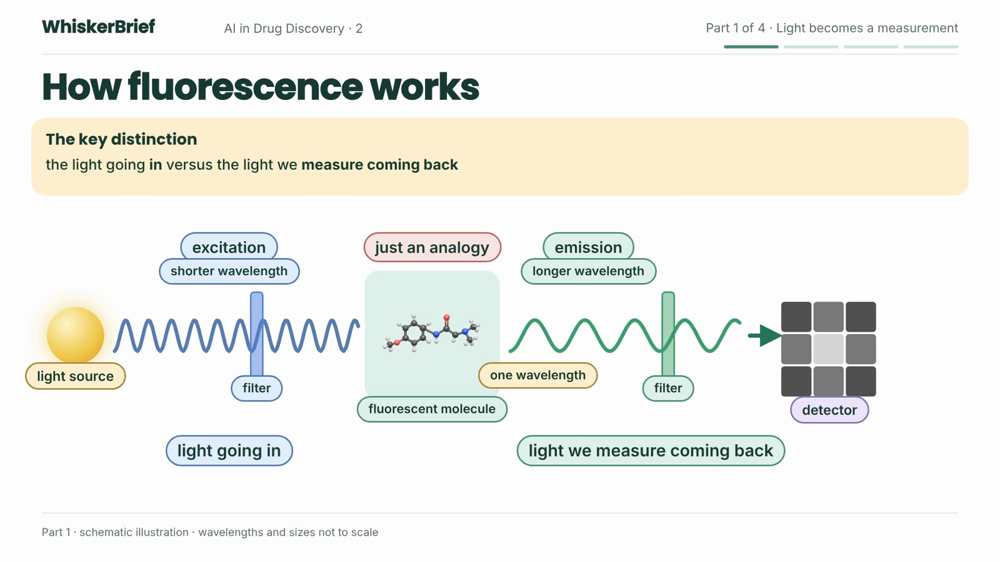
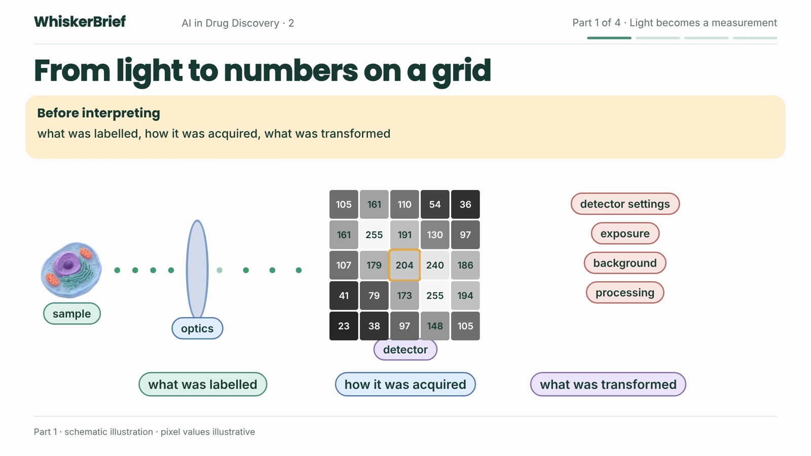
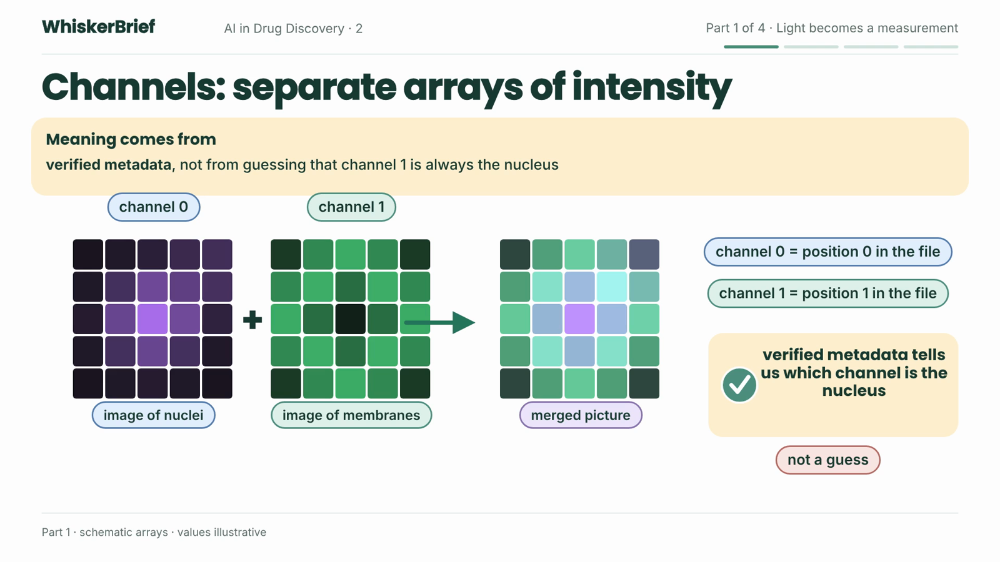
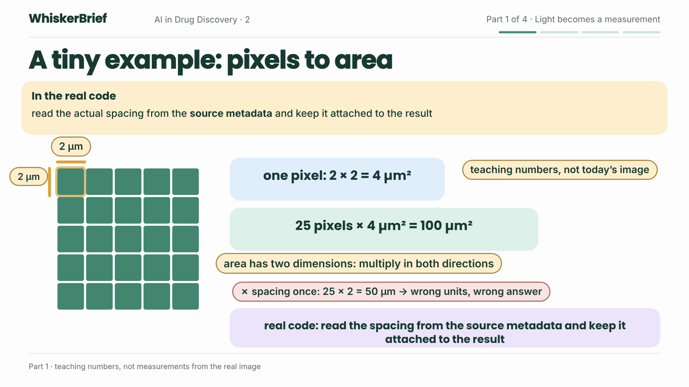
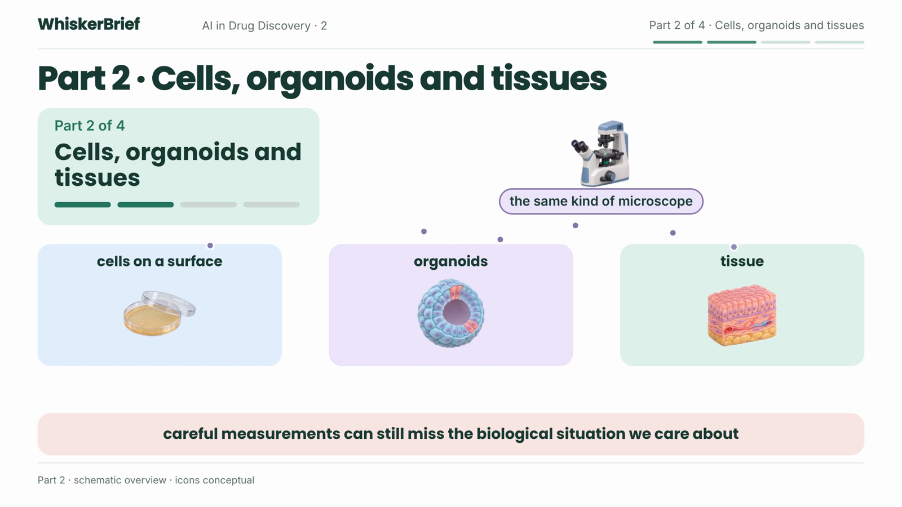
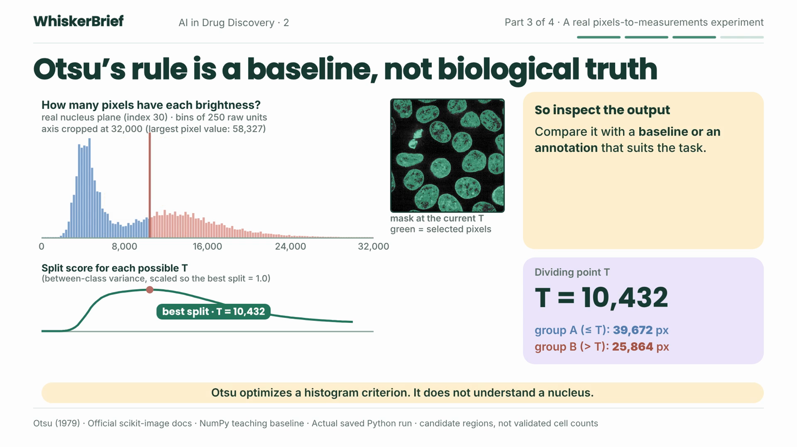
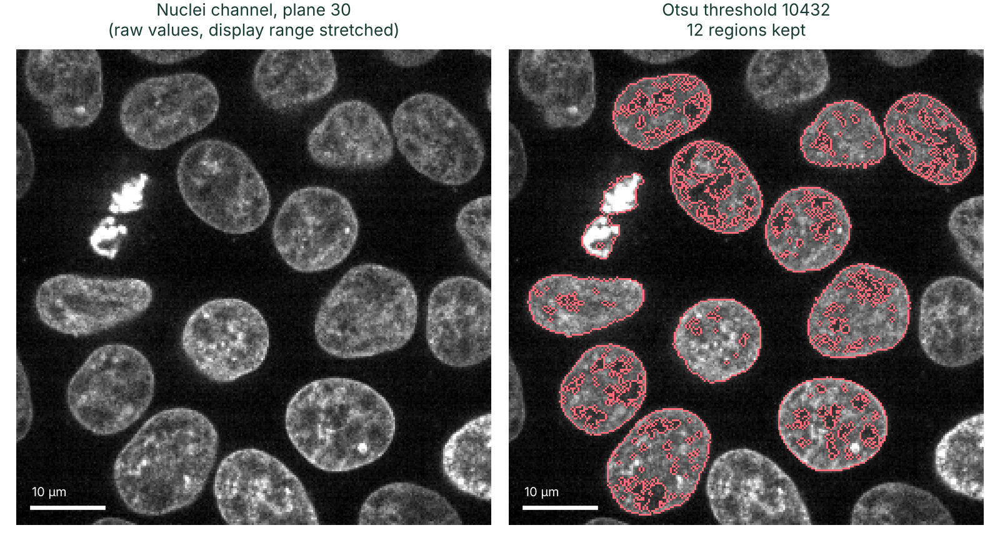
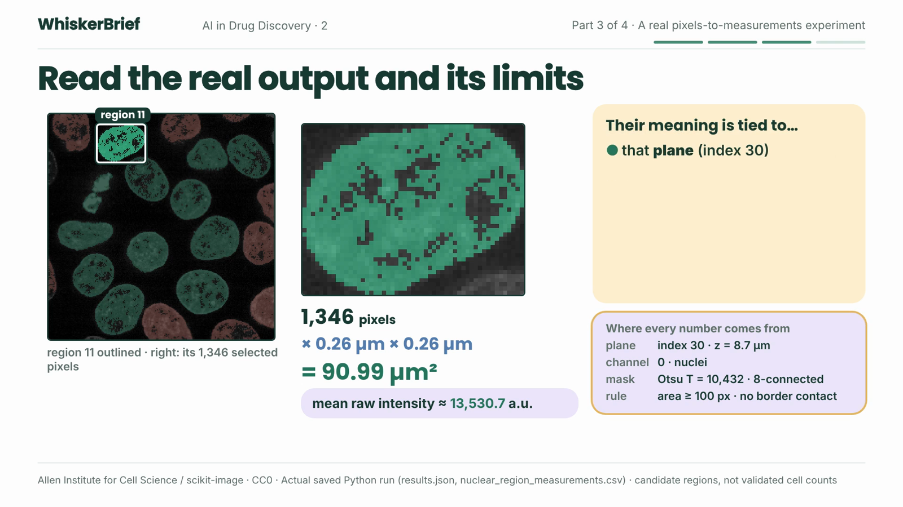
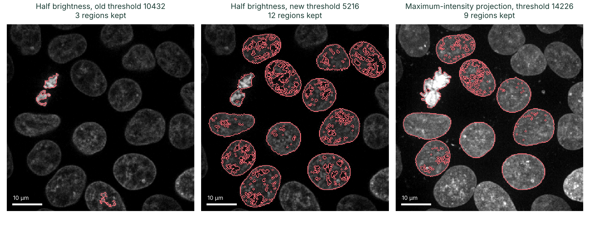
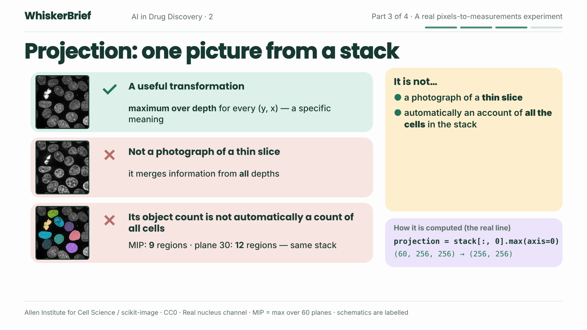

# From Microscope Images to Measurements: Fluorescence, Organoids and a Python Segmentation Baseline

*Part 2 of the AI in Drug Discovery course*

In this tutorial, we will learn how to turn a picture of biology into evidence we can trust. We will follow the chain from light to image, from image to measurement, and from measurement to a carefully limited conclusion.

Imagine that two microscope pictures arrive on your desk. In one, the cells look bright and round. In the other, they look dim and stretched. Someone says the second picture proves that a new medicine is working. Before we ask any AI model to read an image, we need to understand what the image really measures.

We will analyze a real fluorescence image with a simple, transparent method. We will not train an AI model here. The image comes from the Allen Institute for Cell Science and is distributed as the `cells3d` sample in the scikit-image data collection under a CC0 licence. To choose an intensity threshold, we use Otsu's method (Otsu, 1979).

This article follows the second video of the course: [Part 2 on YouTube](https://youtu.be/YD-tiKCHg58). All code is in the GitHub repository: [part-02-microscopy-cells-to-organoids-and-tissues](https://github.com/as4401s/AI-in-Drug-Discovery/tree/main/part-02-microscopy-cells-to-organoids-and-tissues).

We will follow these steps:

1. Light becomes a measurement
2. Cells, organoids and tissues
3. A real pixels-to-measurements experiment in Python
4. What AI adds and what evidence still needs

## Light Becomes a Measurement

Fluorescence begins with a molecule that absorbs light and then emits light. The light we supply is called excitation. The light given off afterwards is called emission, and it usually has a longer wavelength. Filters help the instrument select the excitation light and collect the emitted light.



*Figure 1. Light going in versus light coming back. Source: image created by author (frame from the video).*

A fluorescent label connects this signal to something we want to study. One stain may highlight the DNA-rich nucleus, another may outline the cell membrane. A bright nucleus image does not show every structure in the cell, so we are measuring a labelled signal and not an all-knowing portrait of the cell.

The optics form an image, and a detector converts the incoming signal into numbers on a grid. Each small element of the grid is a pixel. A saved image is therefore an array of numbers with an experimental history.



*Figure 2. The detector turns light into numbers on a grid. Source: image created by author (frame from the video).*

If we acquire one image of nuclei and one of membranes, we store them as separate channels. Each channel is its own array of intensities. Channel 0 and channel 1 are only positions in a file. Their biological meaning comes from verified metadata, not from guessing that the first channel is always the nucleus.



*Figure 3. Channels are separate arrays. The display colors are for our eyes only. Source: image created by author (frame from the video).*

What can brightness tell us? Under controlled conditions, intensity helps us compare labelled signals, but twice the brightness does not automatically mean twice the amount of protein. We call the raw detector values arbitrary intensity units, unless the experiment provides a justified calibration.

Two practical problems matter here. Background and noise add signal that is not the structure we want. Saturation is worse, because a detector has a highest recordable value, and once a bright region reaches it, stronger signals all receive the same number. Changing the contrast later cannot bring those differences back. So we check the raw values, the acquisition settings and the clipped regions before we interpret brightness.

Finally, we connect the grid to physical space. The pixel spacing tells us how much distance in the sample one pixel step covers. Let's work a tiny example. If each pixel is 2 micrometers wide and 2 micrometers tall, one pixel covers 2 x 2 = 4 square micrometers. A region of 25 pixels then covers 25 x 4 = 100 square micrometers. We multiply the spacing in both directions, because area has two dimensions.



*Figure 4. From pixels to area. These are teaching numbers, not measurements from the real image. Source: image created by author (frame from the video).*

## Cells, Organoids and Tissues

The same microscope can look at very different biological systems, and each one keeps a different amount of context.

A cell culture keeps cells under controlled laboratory conditions, often as a flat layer. It is easy to image many times, but it is a simplified environment. If we measure a change in the shape of cultured cells, our first conclusion is about those cells, under those conditions, at that time.

An organoid is a three-dimensional laboratory culture that reproduces selected features of an organ or tissue. The important word is selected. An organoid is not a miniature person. Three dimensions also bring new difficulties: a treatment may not reach every internal region equally, and light has to pass through material. A dark center in an image does not prove that the cells there are dead.

Tissue is an organized collection of cells and surrounding material. It can preserve relationships between cell types, but a tissue section is still a thin sample of a larger structure.



*Figure 5. Cells on a surface, organoids and tissue answer different questions. Source: image created by author (frame from the video).*

To look at depth, we can acquire images at a series of focal positions. The result is a Z stack, and the letter Z names the depth axis. A maximum-intensity projection then keeps the brightest value along depth for every position. It helps us show a stack in one picture, but it collapses depth, and two nuclei that sit above each other can overlap in the result.

A real study shows how specific such a design is. A 2019 paper in Communications Biology described a screening approach with patient-derived tumor organoids. The authors measured the viability, number and size of organoids from four patient-derived cultures after exposure to 240 kinase inhibitors. This is much more specific than saying that an attractive organoid picture predicts which treatment will help a person.

## A Real Pixels-to-Measurements Experiment

Our input is a stack of 60 depth planes with 2 channels and 256 x 256 pixels in each plane. One channel marks nuclei and the other marks membranes. There is no treatment versus control here, so we are not claiming any drug response. We ask a narrower question: can we inspect the file, make a transparent mask, and document the measurements and their weaknesses?

The complete script is `microscopy_demo.py` in the repository, and every step has a comment that explains it. Here we walk through the main parts.

The first step is surprisingly ordinary. We read the dimensions, the data type, the channel information and the pixel spacing before we pick an image. Now, we'll reshape the 120 pages of the TIFF file into a four-dimensional array.

```python
channels = int(metadata["channels"])
depths = int(metadata["slices"])
# axes are: depth, channel, image row, image column
stack = np.stack(frames).reshape(depths, channels, *frames[0].shape)
```

There is one warning worth remembering. The file with metadata and the library's sample array use different channel orders. We compare the real pixels with the official copy, and we find that in our file channel 0 marks nuclei and channel 1 marks membranes. Shape tells us the arrangement, and verified metadata tells us what the arrangement means.

Next, we choose one depth plane, index 30, and the nuclei channel. Numbering starts at 0, so this is the 31st stored plane. Choosing a plane is an analysis decision, so the script saves it with the output.

To measure individual regions, we need to select their pixels. This is called segmentation, and a binary mask puts every pixel into one of two groups, foreground or background. Our baseline rule is simple: pixels above a threshold belong to the foreground. We choose the threshold with Otsu's method. Imagine a histogram that counts how many pixels have each brightness value. For every possible dividing point, the method looks at the two groups it creates and prefers the split that separates them best.

```python
histogram = np.bincount(image.ravel(), minlength=65536).astype(np.float64)
count_low = np.cumsum(histogram)
weighted_low = np.cumsum(histogram * np.arange(65536, dtype=np.float64))
count_all = count_low[-1]
denominator = count_low * (count_all - count_low)
score = np.divide(
    (weighted_low[-1] * count_low - weighted_low * count_all) ** 2,
    denominator,
    out=np.zeros(65536),
    where=denominator > 0,
)
return int(np.argmax(score))
```

The method does not know what a nucleus is. It only optimizes a histogram criterion, so its output must always be inspected.



*Figure 6. The histogram of the nuclei plane and the threshold that Otsu's method chooses. Source: image created by author (frame from the video).*

A binary mask only tells us which pixels were selected. To get separate proposed objects, the script groups neighboring foreground pixels into connected components. Pixels that touch along an edge or at a corner belong together, so an interior pixel has 8 neighbors. We then keep only regions of at least 100 pixels that do not touch the image border, because an object cut off by the border has an incomplete area.

```python
labels, objects = label_components(image > threshold)
small = sum(obj["area_px"] < MIN_AREA_PX for obj in objects)
border = sum(obj["area_px"] >= MIN_AREA_PX and obj["touches_edge"] for obj in objects)
accepted = [obj for obj in objects if obj["area_px"] >= MIN_AREA_PX and not obj["touches_edge"]]
```

For each retained region, the script converts the pixel count into square micrometers and calculates the mean raw intensity. The column names say what was selected, for example "mean raw intensity", instead of a vague word such as "cell size".



*Figure 7. The nuclei channel (left) and the 12 regions that remain after the quality filters (right). Source: image created by author from the Allen Institute cells3d sample (CC0).*

Here are the real results of our run:

| Quantity | Value |
|---|---|
| Otsu threshold | 10432 raw intensity units |
| Connected regions found | 92 |
| Removed because smaller than 100 pixels | 70 |
| Removed because they touch the border | 10 |
| Regions kept | 12 |
| First kept region | 1346 pixels, 0.26 x 0.26 micrometers per pixel, so 90.99 square micrometers |
| Mean raw intensity of that region | about 13530.7 arbitrary units |

These are 12 retained two-dimensional regions under this method. They are not 12 validated cells in the whole stack.



*Figure 8. One retained region and how its area and mean intensity are calculated. Source: image created by author (frame from the video).*

Now, we'll test how fragile this baseline is. First, we multiply all intensities by one half. This is a mathematical change of existing data, not a new experiment. If we keep the old threshold, only 3 regions remain instead of 12. If we recompute the threshold on the rescaled image, the program finds 12 regions again, with the same binary selection as before. Second, we run the same method on a maximum-intensity projection through the stack, which keeps 9 regions.



*Figure 9. Left and middle: the half-brightness image with the old and the re-estimated threshold. Right: the maximum-intensity projection. Source: image created by author from the Allen Institute cells3d sample (CC0).*

What have we learned? A fixed threshold is sensitive to intensity scale, and the adaptive rule handled this artificial rescaling. That does not mean that either mask is biologically accurate, because a stability check and an accuracy check ask different questions. A method can repeat the same mistake very consistently. The projection result does not mean that 3 cells vanished either. The input changed from one plane to a picture that combines the brightest signal along depth, so the two counts describe different things.



*Figure 10. What a projection is and what it is not. Source: image created by author (frame from the video).*

The script also saves everything that someone else would need: the source image identity, channel order, selected plane, physical spacing, threshold method, connectivity rule, size filter and the actual output. It states clearly that the masks were not validated against expert ground truth. Reproducible means that another person can repeat the procedure. It does not mean that the procedure answers every biological question correctly.

## What AI Adds and What Evidence Still Needs

A trained segmentation model uses images paired with reference masks. The image is the input, the reference pixel labels are the target, a loss measures the disagreement, and an optimizer changes the parameters. This is the same loop that we met in the first part of the course, now applied to images. Our script does not train or run such a model.

To evaluate a mask, one simple measure is intersection over union. The intersection holds the pixels selected by both the prediction and the reference, and the union holds the pixels selected by either one. If 6 pixels are shared and the union has 10 pixels, the score is 6 / 10 = 0.6, and a perfect overlap gives 1. A single score cannot tell us whether every nucleus was separated correctly. A merge combines two real objects into one region, and a split turns one object into several, so we also inspect overlays and count these errors.

Evaluation also depends on how we separate the data. If almost identical crops from the same image are in both training and test sets, the test is much easier than a new experiment. Depending on the study, we may need to hold out whole wells, independent preparations or whole laboratories.

Synthetic images can help as well. SynOrg (Bhattiprolu, bioRxiv preprint) generates simulated three-dimensional fluorescence images of organoids together with exact label masks, so the correct answer is known by construction. Known labels are valuable, but they are known inside a model of the world. A method can do well on simulated data and still struggle on real samples. This mismatch is called a domain gap.

Let's return to the two pictures from the start. A convincing treatment comparison needs compatible samples and acquisition, a defined dose and time, appropriate controls and independent biological repeats. A vehicle control receives the substance used to deliver the treatment, but not the active compound. We also check whether segmentation errors differ between the groups. A treatment that makes nuclei dimmer could make a threshold method miss them, which creates an apparent change in object count that comes partly from the analysis.

A trustworthy analysis therefore follows a connected chain:

1. Define the biological question and the sample.
2. Acquire an appropriate signal under documented conditions.
3. Preserve the raw data and metadata.
4. Transform and segment the image with declared choices.
5. Measure quantities with the right units and quality checks.
6. Interpret the result within the controls and validation that the experiment provides.

Here are three questions to test yourself:

1. An image region contains 25 pixels, and each pixel is 2 micrometers wide and 2 micrometers tall. What is its physical area?
2. Two displayed pictures have different brightness, but each was stretched independently. Can you conclude that one sample has more of the labelled protein?
3. A mask contains one connected object where two touching nuclei may be present. What should you call the reported count, and what would help to check it?

The answers are: 100 square micrometers; no, you would need the raw measurements, compatible acquisition and labelling, and controls; and one connected object under the declared segmentation rule, which you check against the original channels and a suitable reference annotation.

We can now answer the question from the start. A microscope image gives a rich observation of a labelled sample, and its meaning depends on the label, optics, detector, scale, preparation and biological context. A transparent analysis turns selected pixels into useful measurements, but a mask and a number stay tied to their assumptions and validation. The habit to keep is simple: ask what was actually measured, what changed during processing, and what evidence connects the measurement to the conclusion.

In the next part, we ask how drug discovery chooses a biological target, and how our EGFR and KRAS examples fit into that process. Hope this article helps all those who want to understand microscopy data before they apply AI to it.

## References

1. Otsu, N. A threshold selection method from gray-level histograms. IEEE Transactions on Systems, Man, and Cybernetics 9(1), 62-66 (1979).
2. Allen Institute for Cell Science. `cells3d` fluorescence sample (nuclei and membranes), distributed in the scikit-image data collection, CC0.
3. A simple high-throughput approach identifies actionable drug sensitivities in patient-derived tumor organoids. Communications Biology 2 (2019). DOI: 10.1038/s42003-019-0305-x
4. Bhattiprolu, S. Parametric Physics-Based Synthesis of 3D Fluorescence Organoid Images with Exact Ground Truth for Deep Learning Pipeline Development. bioRxiv preprint. DOI: 10.64898/2026.04.16.719066
5. Code for this article: https://github.com/as4401s/AI-in-Drug-Discovery/tree/main/part-02-microscopy-cells-to-organoids-and-tissues
